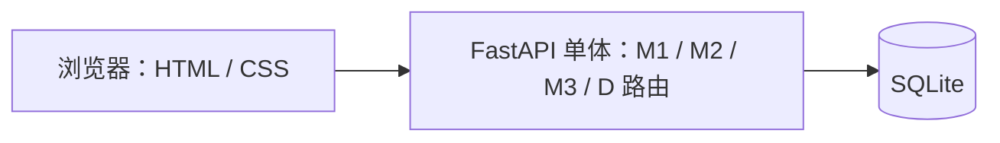

# Review1计划

> 依据：`Pj-任务书.md` 第六节、`PJ-计划书.md` 第四节。计划周期：2026-10-20 至 2026-10-21；Review 日期如有变化，整体平移。
> 本文是本轮需求基线和任务安排，不替代完整需求清单；未纳入本轮的需求继续保留在 `PJ-计划书.md`，标为延期并注明原因。

## 1. 目标与范围

本机启动一个 FastAPI 单体应用，三组各完成一条最小业务链，并有需求、验收和测试记录。只做可演示的主路径，不追求覆盖全部模块需求。

本轮完成：

- 每条本轮需求有需求 ID、负责人和 Given-When-Then 验收标准。
- 三组的任务、公共依赖和先后顺序明确。
- 建立最小应用骨架；提供本地启动方式、SQLite 初始化数据和行为测试。
- 项目负责人建立项目级规则文件，并说明 AI 参与、人工审查和测试的流程。
- 记录主要风险及应对措施。

本轮不做：网关或拆分服务、后台通知、定时任务、动态角色管理、复杂审批、图片上传、生产部署，以及 M2/M3 对 M1 的跨模块写回。以上需求不删除，后续按需求基线延期处理。

## 2. 最小架构

- 后端使用 FastAPI；页面使用 HTML/CSS，需要弹窗时只加少量原生 JavaScript。
- M1、M2、M3、D 在同一个 FastAPI 进程内，各自使用独立路由；暂不拆服务。
- 共用一个 SQLite 文件。保留一个 `V1__init.sql` 和幂等种子数据脚本；不用 ORM 或迁移框架。
- 本轮本机运行并用 pytest 验证；GitHub Actions 只配置一个运行测试的 job。课程服务器部署和发布流程另排时间。
- 当前目录尚无代码骨架，也未检测到 Git 仓库。项目负责人先准备 Git 仓库、基础目录和应用入口，再开始并行开发。

建议骨架：`app/main.py`、`app/common/`、`app/m1/`、`app/m2/`、`app/m3/`、`app/d/`、`web/templates/`、`web/assets/`、`database/migrations/`、`tests/`、`docs/`。具体建目录由项目负责人后续完成，本计划不创建代码骨架。

## 3. 本轮需求基线与三组功能

| 负责人 | 需求 ID | 本轮实现 | 验收标准 |
|---|---|---|---|
| G1（A、B） | M1-R03、M1-R07 | 搜索自习座位并提交预约。预约按整点小时计算，最多 4 小时；拒绝时段冲突或超时长预约。 | Given 已有座位和开放时段，When 学生按教室、时段查询，Then 只显示可预约座位；When 预约 1–4 小时且无冲突，Then 保存预约；超时长或冲突时，Then 拒绝并显示原因。 |
| G2（C、D） | D-R01、D-R02、M2-R01、M2-R02、M2-R03（部分） | 实现账号登录和服务端会话 Cookie；用种子账号提供固定角色权限；提交整教室申请，并完成一级通过/驳回。暂不做角色配置页面和二级审批。 | Given 学生与审批员演示账号，When 使用正确凭据登录，Then 获得 HttpOnly 会话 Cookie；退出后会话失效。学生可提交必填信息完整、人数不超过容量的申请；只有审批员能把待审申请改为通过或驳回。 |
| G3（E、F） | D-R03、M3-R01、M3-R02、M3-R03（部分） | 初始化少量虚构的楼宇、教室、座位和演示用户；提交文字报修、手动派单，将工单从 `REPORTED` 推进到 `ASSIGNED`、`IN_REPAIR`。 | Given 空数据库，When 初始化和种子脚本各运行两次，Then 演示教室和座位存在且没有重复数据；When 用户提交有效文字报修并由管理员指派，Then 工单按上述状态顺序更新。 |
| 三组页面共同 | D-R04（简化） | 当前操作完成后在页面显示即时弹窗或结果提示；不保存通知记录，不做后台推送、消息中心、邮件或短信。 | Given 用户完成或提交失败一次操作，When 页面返回结果，Then 显示对应的成功或失败提示；不产生异步通知。 |

G2 的固定角色只用于本轮演示，不实现管理员动态增删角色/权限。G3 的主数据只通过种子数据提供，不实现管理端 CRUD。表内标为“部分”的需求，其余部分保留在总需求基线中并标为延期。

### 本轮明确延期

- M1-R01 的管理功能、M1-R02 的角色配置、M1-R04 至 M1-R06 的签到/提醒/自动取消、M1-R08 至 M1-R10 的历史、统计和来源追溯。
- M2-R03 的第二级审批，以及 M2-R04 超时撤销、M2-R05 撤销/状态查询、M2-R06 占用 M1 座位。
- M3-R04 超时升级、M3-R05 验收评价、M3-R06 座位下架与恢复。
- D-R05 操作审计，以及 M3→M1、M2→M1 两条跨模块写回链路。

延期原因：先完成可运行的模块主路径；后续按 Review 2 计划补充。

## 4. 任务拆分与依赖关系

| 顺序 | 任务 | 负责人 | 依赖与产出 |
|---|---|---|---|
| 0 | 准备 Git 仓库、上述基础目录、FastAPI 入口、SQLite 连接方式、项目级规则和 AI 协作说明 | 项目负责人 | 三组开工前完成；对应 Review 1 的架构与规则交付。 |
| 1 | 冻结共用字段：用户/角色、房间/座位 ID、预约时段、申请状态、工单状态；确定演示账号和验收口径 | 三组代表，项目负责人记录 | 任务 0 后完成；之后不随意改公共字段和状态名。 |
| 2 | 汇总各组所需表结构，建立唯一的 `V1__init.sql` 和幂等种子数据 | G3 汇总；G1、G2 提供各自字段 | 任务 1 后开始；先交付房间/座位/用户种子，阻塞 M1、M2、M3 集成。 |
| 3 | 登录、固定角色判断和 M2 申请/一级审批 | G2 | 依赖任务 0、1；M1 和 M3 使用同一登录接口与角色名。 |
| 4 | M1 搜索与预约规则 | G1 | 依赖任务 2 的座位数据和任务 3 确定的会话接口。 |
| 5 | M3 报修、手动派单和基础状态流转 | G3 | 依赖任务 2 的房间/座位数据和任务 3 确定的会话接口。 |
| 6 | 每组补行为测试，接入一个 GitHub Actions pytest job，三组一起本机演示 | 各组；项目负责人汇总 | 任务 3–5 完成后；至少覆盖一条成功路径和一条拒绝/错误路径。 |

公共表结构和登录接口由任务 1 先定契约，避免三组同时修改同一个文件。每组只改自己的模块目录；需要改公共接口时，由项目负责人协调三组确认。

## 5. 项目规则与 AI 协作

项目负责人在建立项目骨架时一并建立根目录 `AGENTS.md` 和 `.agents/notes/README.md`：前者作为 Agent 的规则入口，后者规定面向 Agent 的 ADR Note 格式与状态。`docs/ai-collaboration.md` 作为给组员和老师看的协作流程说明，不复制 Agent Note 的决策理由。最少写清：目录与启动/测试命令、模块边界、共享数据库及接口的变更方式、测试要求、禁止使用真实学生数据或提交凭据。

决策 Note 放在 `.agents/notes/{proposed|implemented|rejected}/{主题}/`，按 ADR 格式记录问题、备选方案和取舍。新提案先放 `proposed`，采纳后移到 `implemented`；明确否决且值得防止重议的才移到 `rejected`。被后续决策取代时，新 Note 写 `Supersedes: ADR-xxx`，旧 Note 写 `Superseded by: ADR-yyy` 并互相链接，不重写旧决策理由；`superseded` 是取代关系，不另建状态目录。`docs/decisions/README.md` 仅作人类索引和会议记录入口。

每个任务按以下流程进行：

1. 人先写任务卡：需求 ID、改动范围、不做项、验收标准。
2. AI 先给短方案和预计改动文件；组员确认后再让 AI 实现。
3. AI 每次只改一个小范围；涉及公共表、登录或跨模块接口时先暂停并由三组确认。
4. 组员人工检查 diff，运行对应 pytest 和页面验收；只报告实际运行的命令与结果。
5. 人工验收后由组员提交；不把真实账号、密码、学生数据或密钥交给 AI。

## 6. 两天安排与风险

| 时间 | 重点 | 完成标志 |
|---|---|---|
| 第一天上午 | 项目负责人建骨架和规则；三组冻结字段、状态和验收标准 | 应用能启动；公共契约写在本文或需求基线中；任务分派到组。 |
| 第一天下午 | G1、G2、G3 并行完成各自的核心页面/路由；G3 提供种子数据 | 三组各自至少跑通一条成功路径。 |
| 第二天上午 | 合并到同一个 FastAPI 应用；补冲突校验、角色校验和失败提示 | 三组在统一 SQLite 数据上互相不阻塞。 |
| 第二天下午 | 行为测试、GitHub Actions pytest job、需求状态和风险记录、演示彩排 | 浏览器可演示三条最小业务链；未完成项有延期原因。 |

| 风险 | 应对 |
|---|---|
| 共用登录或数据库字段晚确定，导致三组返工 | 第一天上午冻结契约；G2 先发登录/角色接口说明，G3 汇总唯一迁移脚本。 |
| 两天内不断加需求，主路径无法集成 | 以第 3 节为范围上限；新增想法记入延期项，不插入本轮。 |
| AI 生成的测试只验证常量或 mock 掉业务逻辑 | 每组至少测可观察结果和一条失败规则；人工检查测试确实调用应用逻辑。 |
| 本地能跑但 Git/评审证据缺失 | 项目负责人先初始化 Git；每天保留小提交，合并前由人审查。 |
| 两天内无法准备课程服务器 | 本轮只保证本地演示和 GitHub 测试；服务器部署列为后续任务并记录风险，不临时搭复杂环境。 |

## 7. Review 1 对照

| 任务书要求 | 本文对应内容 | Review 时展示的证据 |
|---|---|---|
| 需求基线 | §3 | 需求 ID、范围、部分实现标记和 Given-When-Then 验收。 |
| 任务分解与依赖关系 | §4 | 任务负责人、先后关系和共享接口冻结记录。 |
| 架构搭建和第一次迭代功能 | §2、§3、§6 | 本机启动的单体应用和三组各一条浏览器业务链。 |
| 项目级规则文件与 AI 协作方式 | §5 | 根目录 `AGENTS.md`、`.agents/notes/README.md`、人类可读的协作说明，以及一次经人工审查的小任务记录。 |
| 风险识别 | §6 | 风险、应对和延期项记录。 |
